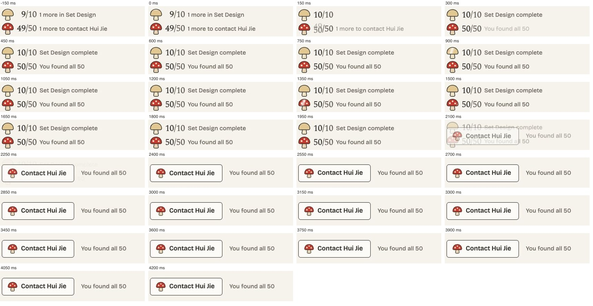

# The two-mushroom counter and the phone view: build report 01

From: Fable. For: Wren and the user. 2026-11-25. Brief: `reviews/hunt-counter-build.md`; spec:
`HANDOVER-hunt-counter.md` §2–4. Branch: `site/counter`, made from `origin/site/scene-5` with round 4 on it, with the
handover and `BIBLE.md` brought from `main` by path. Nothing was merged and `main` was not touched.

**To see it**

```
cd ~/hjaas && git checkout site/counter && git pull && cd site && npm install && npm run dev
```

- http://localhost:5173/?all=16#grow (a find), `?all=19#grow` (a scene's tenth), `?all=49#set` (the unlock).
- The phone: `?reset#build` on an upright phone. Wait for the painting to end, then the room drifts once.
- Recordings: `site/qa/counter/*-60fps.mp4`; the same as strips, every 150 ms from the landing: `strip-*.jpg`.



## 1. What was asked, and the result

| | Asked for (brief §) | Result | Evidence (`site/qa/counter/…`) |
|---|---|---|---|
| ✅ | Branch (§0) | As asked. | `git log` |
| ✅ | Two counters, cream above red, drawn in code (§1) | `caption.ts`. Cap 28 × 17, stem 12 × 12, 1.5 px line, the spec's four colours. Ink is the page's own (`#302e29`). | `open-*.jpg` |
| ✅ | Fill, numbers, 90 ms, labels (§1) | Cream rolls on the landing, red 90 ms later (first seen at 17 and 101 ms); old up 8 px, new from 8 px below. Labels switch at half, with the tab's own name. | `timing.json` |
| ✅ | The flying mushroom lands on the cream one (§1) | The fill starts in the frame after the landing. | `find-*-60fps.mp4` |
| ✅ | 10/10: glint, dot, Next (§1) | Glint 450 ms (seen 467 to 1350), dot with it, Next at 650 ms, a real link, 45 px to a finger. | `timing.json`, `complete-*` |
| ✅ | 50/50: glint, then the button (§1) | Red glint 900 ms (seen 916 to 1816), cross-fade 2000 (seen 2033 to about 2450), 4 px. Focus goes to the button. | `timing.json`, `unlock-*` |
| ✅ | Return visits (§1) | Watched from the first frame with 17, 20 and 50 found: only the page's own 200 ms fade. With 50 the button is there in the first frame. | `states.json`, `return-*` |
| ✅ | Reduced motion (§1) | No roll, fill, glint or rise. Dot, Next and cross-fade by opacity. | `*-reduced-60fps.mp4` |
| ✅ | Accessibility (§1) | `role="img"` and labels on both; one polite live region; a tab with a dot also says ", all found". | `states.json` |
| ✅ | Remove the old words (§1) | "You found all 10", "3 of 10 found" and "Swipe sideways" are gone. No enamel pin was left in the code. | `states.json` |
| ✅ | One store, one rule (§2) | `huntView()` in `state.ts`: counters, dots, Next and the unlock all read it, and it uses the rule that was there. A new test checks 400 hunts from all five scenes; the page was checked against storage for 13 hunts × 5 scenes: 0 differences. | `unlock.test.ts`, `states.json` |
| ✅ | Window 55 to 65% of the screen, all on screen (§3) | 58.2% at 375×667, 62.9% at 390×844, 63.4% at 430×932. Everything fits with no scrolling. The clamp had to change (section 2). | `phone.json` |
| ✅ | Opens centred on Rachel (§3) | One `focusX` per scene replaces `phoneStart`. She is within 19 px of the middle everywhere. **Film: see section 6.** | `phone.json`, `open-*` |
| ✅ | The drift (§3) | 0.8 s after the painting, 40 px and back in 2.4 s, first visit only. Not with reduced motion, on a return, in a visit where another scene was seen before, or on its side. A finger stops it where it is. Nothing is saved. | `states.json`, `drift-portrait-60fps.mp4` |
| ✅ | Hint skips (§3) | Only a mushroom wholly on screen; with none, nothing moves. | `states.json` |
| ✅ | Counters under the scene, controls on a row below (§3) | `--caption-h` 114 px; nothing overlaps. | `phone.json` |
| ✅ | On its side (§3) | Whole room, counters and controls on one screen at both sizes. It did not fit before: changed (section 2). | `open-844x390.jpg`, `open-932x430.jpg` |
| ✅ | The whole hunt | 50 taps on 50 drawings, Next from scene to scene, then the button and the form: desktop, upright and on its side. None missed. | `hunt.json` |
| ✅ | 60 fps recordings (§4) | Sixteen. Find: no gap over 17 ms on any device. Drift: 33 ms at most. The gaps of 50 to 83 ms at the end of the glints come after the light has left the cap. | `record.json` |
| ⚠️ | Trace: no dropped frames (§4) | **Not quite.** Nothing drops from two frames after the landing on: rolls, fills, glints and the cross-fade are clean in all 18 runs. Some drop at the tap and, on slow runs, in the first two frames of the landing. Section 3. | `trace.json`, `../traces/SUMMARY.md` |
| ✅ | WebKit (§4) | A find, a scene's tenth and the unlock on the iPhone profile: right, no errors. Section 3. | `webkit.json`, `webkit-*.jpg` |
| ✅ | Tests, types, console | 215 tests pass, type check clean, no console errors. | |

## 2. What changed, beyond the counter itself

- **Portrait height.** It was 1.25 to 1.5 times the window's width. At 375×667 that gave 424 px (63.5%) and the page
  would scroll about 25 px. Now: 55 to 65% of the screen, never taller than 2:3, **never under 355 px**, the least at which no
  two tap boxes meet. On a 320×568 phone that floor is used, and the page scrolls about 110 px.
- **The masthead's real height** (its line runs to two on a phone) is now in the sum, which also fixes 7 px of scrolling at 1920×1080.
- **On its side.** The masthead took 143 px and wrapped. Now the identity, tabs and caption run the width of the page,
  closed up, and the picture takes what is left: 465 px wide at 844×390, 537 at 932×430 (never under 440).
- **Tap boxes always cover their drawing.** On its side, a box near the soft edge was moved so far in that tapping the
  mushroom itself missed (the toolbox and the café's corner, in the build before too). Fixed in `edge.ts`; sizes
  already tested are unchanged. Boxes do overlap by a few px on their sides there; no box reaches another's middle (new test).
- **The tab dot's room.** The gap between tabs on phones went from 26 to 23 px.

## 3. Frame times

Same phone profile, 4× slower, production build, the build before run in turn, six runs each (dropped frames):

| | At the tap | In the flight | First two frames of the landing | After that |
|---|---|---|---|---|
| A find | 1 to 5 | 0 | 1 in two runs of six | 0 |
| (before) | 1 to 5 | 0 | 1 to 3 in three of six | 0 |
| A scene's tenth | 0 to 6 | 0 | 1 in three of six | 0 |
| The fiftieth | 1 to 7 | 2 in two of six | 2 in two of six | 0 |
| (before) | 1 to 4 | 0 | 2 in one of six | 0 |

- **The tap** is the find itself (the mushroom taken off, her answer begun) and was so before; nothing has moved yet.
  I left it alone.
- **The same work takes two to three times longer in some runs than in others,** in both builds. In the quick runs
  nothing drops. A real phone will say more than this machine can.
- **Found and fixed on the way:** the "→" is not in the site's font, and looking for one froze the page 96 to 160 ms
  as Next appeared (it is drawn now); text laid out for the first time at a landing (laid out, unseen, while the page
  loads); the whole page laid out again for one digit; the fills and glints now run on the compositor.
- **WebKit, two runs each, longest frame.** At the tap: 20 to 51 ms (before: 20 to 43). From the flight on: 19 to 24
  ms, except the fiftieth at 42 and 32 (before: 19 to 30).
- The traces are a script's, not the DevTools MCP's, and headed; same profile and processor rate.

## 4. Against the animation standards (`.claude/skills/review-animations/STANDARDS.md`)

| | Standard | The counter |
|---|---|---|
| ✅ | Should it animate | A find is occasional; ten and fifty are rare. A scene change is one short fade; a return visit nothing. The find and Next also work from the keyboard, with the same short answer as a tap (it is feedback, not navigation). |
| ✅ | Easing | Rolls and cross-fade `(.23, 1, .32, 1)`; glint the spec's `(.645, .045, .355, 1)`; drift sine in-out; label and dot fades `ease` and ease-out. Never ease-in. |
| ⚠️ | Under 300 ms | Rolls 160 and 200, dot and Next 260. The fill (500), the glint (900) and the cross-fade (450) are longer: the spec's numbers, for rare moments. |
| ✅ | Physicality | Nothing comes from `scale(0)`: a fill is covered and uncovered; the dot from 0.9 and no opacity. The button still presses to 0.98. |
| ✅ | Interruptible | A second find cuts the roll short and re-aims the fill (a transition). Four finds 60 ms apart and three in one frame count right. A scene change ends everything. |
| ✅ | Performance | `transform` and `opacity` only. The small parts have their layers from the start, so a landing makes none. |
| ✅ | Origin, stagger | The fill rises from its base; the red row 90 ms after (the spec's). |
| ⚠️ | Crossfades | For about 0.15 s the two rows and the button are seen through each other. The standard's cure is a 2 px blur; the spec asks for none, so I added none. |
| ✅ | Reduced motion | No movement; opacity or instant. |
| ✅ | Hover gated; touch | Next's hover is behind `(hover: hover)`. Tap targets 44 px and up. |
| ✅ | Cohesion | The page's own curves and fonts, no new ones. |

## 5. Decisions I made

1. **The mockup could not be opened from this run** (access not granted), so the drawing follows the spec's words and sizes.
2. **At 50/50, before the button,** the red row says "You found all 50" for the two seconds, and the same words stay beside the button.
3. **The hint, once skipped,** is due again after another quiet minute, so the one wiggle is not lost.
4. **Label size on phones:** 15 px, but 14 px at 385 px wide and under, 13.5 px at 373 and under, 13 px at 349 and under, so "Set Design complete" and Next share a row. At 349 and under Next is "Build →" (the word is still read out).
5. **Spots on the red cap** are uncovered with the fill, so an empty cap is plain paper.
6. **The drift moves the plate, not the scroll position:** scroll is whole pixels and a slow drift showed them. "First visit" means no scene has been painted for them before.
7. **Where Rachel's middle is:** between the middle of her body and the middle of her reach, without her furniture.
8. **The contact form's "sent" mushroom** is the new red one too.

## 6. For Wren

1. **Film on a phone loses the presenter.** Centred on her (plate x 1195, was 977), his face is a swipe to the left and
   only his hand shows (`open-390x844-film.jpg`). Your review of Film build 01 had chosen 977 for both faces, and the
   user approved that on a phone. I followed the newer brief. `focusX: 977` in `src/scenes/film.ts` undoes it (and the
   test beside it). Build also loses the far end of her box.
2. **Look at** `strip-unlock-desktop.jpg` around the cross-fade, and `drift-portrait-60fps.mp4` for how gentle it is.
3. **On its side the picture is small** (465 × 262 at 844×390) because everything fits one screen. The mushrooms are 5 px
   or so there. A real phone's browser bars take more; then the page scrolls a little.
4. **How much of the room is in view upright:** 38% (49% at 375×667), under the handover's "about half". A shorter window would show more: 55% of the screen is about 43%.

## 7. What was not done

- **No real phone.** The user's phone check is next, above all the portrait crop and the drift.
- The older QA tools (`review01` to `03`, `scene2`, `scene5`, `same-as-before`) look for the old caption's classes
  (`.hj-tally`, `.hj-note`, `.is-waiting`) and were not rewritten. `qa/tools/counter.mjs` covers what they asked of it.
- The recordings, traces and WebKit runs were made just before the last change (the tap boxes and the 355 px floor),
  which alters neither those screens nor the counter. The tests, the phone stills and the whole hunt were run after it.
- Memory, the painting and the edge checks were not run again in the browser (the edge's unit tests were).
- `.DS_Store` and `.impeccable/` were untracked in the working tree before I started; nothing tracked was changed. I left them alone.
