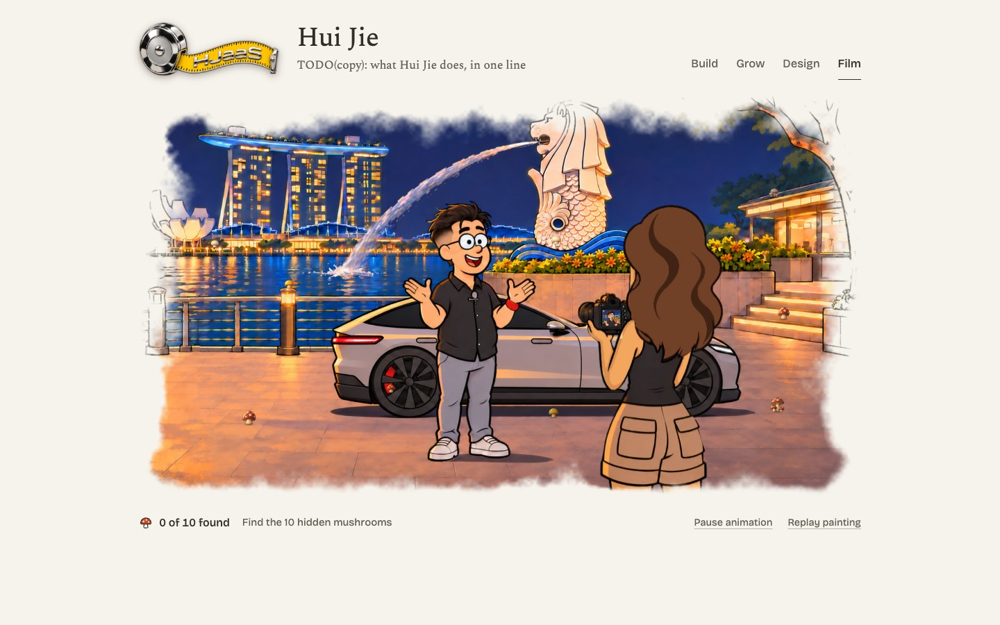
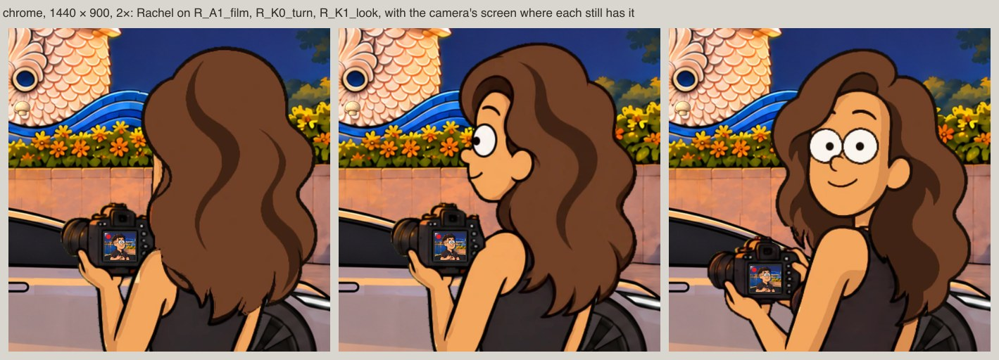
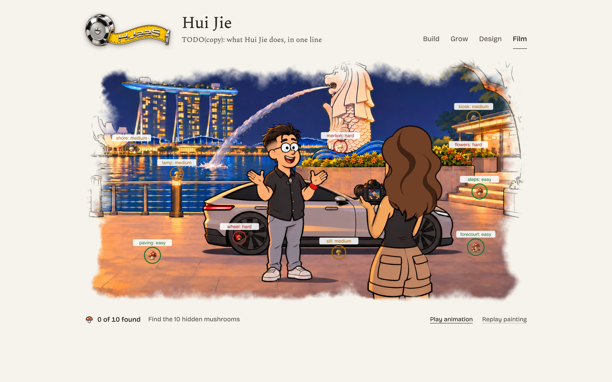

# Scene 4 "Film": build report 01

From: Fable. For: Wren and the user. 2026-11-21. Brief: `reviews/scene-4-build.md`.
Branch: `site/scene-4`, made from the tip of `site/scene-3` and carrying the café up to v7.5. Nothing was
merged into any other branch and `main` was not touched.

**To see it**

```
cd ~/hjaas && git checkout site/scene-4 && git pull && cd site && npm install && npm run dev
```

- Film: http://localhost:5173/#film
- Its first-visit painting again: http://localhost:5173/?reset#film



## 1. What was asked, and the result

| | Asked for (brief §) | Result | Evidence (`site/qa/…`) |
|---|---|---|---|
| ✅ | A fourth tab, "Film", lazy-loaded (§1) | In the menu after Design, at `#film`. Its plate is fetched with the page; its cast when the tab is first opened or hovered. The four tabs fit on one line down to 320 px. | `scene4/film-1440x900.jpg`, `shots.json` |
| ✅ | Built from `frames/020-film-scene/site/` and `film-lines.png` (§2) | `npm run assets` makes `public/assets/scene4/` from the package: plate, 16 stills as WebP at the size delivered (no upscaled set), pencil strips. 1.7 MB in all. The package is a file swap, as the café's is. | `scripts/build-assets.mjs` |
| ✅ | Layers drawn in order, every change an instant cut (§2) | Water, presenter, Rachel, each on its own canvas with its own routine, out of step. No `fade_ms` in the data and no step is ever dissolved. The page against the package's own picture: the presenter and Rachel within 0.7 of a screen pixel of their places. | `scene4/preview.json`, `preview-compare.jpg`, `film.test.ts` |
| ✅ | The live camera screen (§3) | The back of her camera shows the presenter and the bay live: where `rect_by_still` puts it, 2 px inside, to 0.4 of a plate px on all three of her stills. It follows every one of 285 pose changes under it in the same frame (Chrome; 292 in WebKit), and never changes otherwise. It moves with the camera when she turns. | `scene4/screen.json`, `screen-what-*.jpg`, `screen-her-stills-*.jpg` |
| ✅ | The REC dot (§3) | 6 px, `#EB1E1E`, 2 px inside the picture's corner; 500 ms on, 500 ms off: every stretch 499.9 to 500.1 ms in Chrome and 488 to 513 ms in WebKit (one frame either way), straight through her reaction. No loop of its own: it is counted on her player's frames. | `scene4/screen.json` (`theDot`) |
| ✅ | Reduced motion: a still copy, dot on (§3) | One picture in 145 frames, the dot lit in all of them. (Pause takes the same path in the code; I did not measure it separately.) | `scene4/react.json` |
| ✅ | Water: W_1 → W_2 → W_3 at 110 ms, forever (§4) | 184 changes in 20 s, always in order, mean gap 110 ms, longest 117 ms (124 in WebKit), none over 150. | `scene4/screen.json` (`theWater`) |
| ✅ | Presenter: lip-flap, blinks every 2.5 to 6 s, a gesture each way (§4) | 60 s logged in each browser: the gestures in the written order three times round; every in-between (M_12, M_13) 98 to 104 ms; 12 blinks of 100 to 118 ms, 3.2 to 6.0 s apart (mean 4.7 s), each among his M_1 mouths. He never reacts to a find. | `scene4/presenter.json` |
| ✅ | Rachel holds still; on a find she turns, looks, turns back (§4) | R_K0_turn 89 to 92 ms, R_K1_look 1.9 s, R_K0_turn 98 ms, R_A1_film. Her first move comes 1 to 3 ms after the find. | `scene4/react.json`, `film-desktop-stills-find.jpg` |
| ✅ | A second find mid-reaction extends the look, no second turn (§4) | Found again 0.81 s into the look: the look was held 2.43 s in all (1.62 s after the second find), with two turns only. | `scene4/react.json` |
| ✅ | 10 mushrooms, 3 easy / 4 medium / 3 hard, full width (§5) | Section 3 below. Three, three and four in the thirds of the picture. | `scene4/hunt-desktop-circled.jpg`, `hunt-phone-*.jpg` |
| ✅ | Fairness; never on an actor's layer or the camera screen (§5) | Tap boxes 44 px at every size, none overlapping. No drawing touches the water's, the presenter's or Rachel's layer (the nearest, `wheel`, is 7 px from the presenter's); a test holds future packages to it. | `scene4/hunt-checks.json`, `scenes.test.ts` |
| ✅ | `aPaint` ≥ 0.95 under every mushroom and tap box (§5) | 1.00 under every drawing at five sizes; tap boxes 1.00, and 0.996 for one on a 320 px phone. No pencil over a mushroom. | `edge/pencil-spots.json` |
| ✅ | Every mushroom findable | All 40 (four scenes) clicked or tapped on the drawing: desktop, the iPhone profile and a 320 px phone. | `edge/pencil-find.json` |
| ✅ | Pencil edge B with round 3b's reveal (§6) | Film's first-visit painting: the pencil never ahead of the colour's margin, no paint past the colour's edge, bare paper stays paper; the rim is paper all the way round. | `edge/pencil-reveal-film.json`, `pencil-reveal-film-*.jpg`, `pencil-rim.json` |
| ✅ | Presenter, and Rachel above her waist, fully painted (§6) | `aPaint` = 1.00 under all 53,105 points they cover (Rachel above plate y 760), by the formula and on the edge as drawn; the fade comes no nearer than 44 px. Below her waist the edge fades her legs into the paper with the rest of the bottom edge: no cut. | `edge/pencil-rachel.json` |
| ⚠️ | Phones open on x 620 to 1420, both people in frame (§6) | A phone's window is 628 to 752 plate px wide, not 800: the picture is as tall as the screen allows in every scene. It opens centred on the pair: x 663 to 1290 on a 390 × 844 phone. His head and her camera are fully in; his open left hand and the right-hand side of her hair are cut. Panning shows the rest. Section 5. | `scene4/film-390x844.jpg`, `shots.json` |
| MEMORY_ROW
| ✅ | 60 fps on a throttled phone (§7) | Chrome with the processor slowed four times: Film's painting and Film at work 17 ms a frame. Trace: Film at work drops no frames (longest task 6 ms), the painting 2 of 361, a find 3 of 210. Section 4. | `traces/SUMMARY.md`, `scene4/frames.json` |
| ⚠️ | No long tasks over about 12 ms in WebKit (§7) | Film's painting 23 to 24 ms at the longest frame and Film at work 19 to 21 ms (a frame is 16.7), none over 33 ms. Coming back to Film by the short brush: 21 to 41 ms in two runs, and frames of 62 and 83 ms in a third run that was noisy throughout. Section 4. | `scene4/frames.json` |
| ✅ | Screenshots (§8) | 1440 × 900; 390 × 844 and 360 × 740 as they open and panned to each end. | `scene4/film-*.jpg` |
| ✅ | A 20 s recording with one find and one gesture each way (§8) | Desktop and iPhone profile, exactly 20 s each: he points at 1.5 s and comes back at 5.4 s, the find is at 6.4 s, her look ends at 8.7 s, hands together at 12.3 s and back at 15.8 s. Also each one's first-visit painting. | `scene4/film-desktop.mp4`, `film-iphone.mp4`, `film-*-painting.mp4`, `film-*-stills-*.jpg` |
| ✅ | A throttled-phone trace (§8) | Two: the painting, at work and a find; and round the four scenes. | `traces/SUMMARY.md` |
| ✅ | Checked against the animation standards (§8) | Section 6. | |

Tests: 172 pass (`npm test`), 48 of them new for this scene. `tsc` clean, production build fine.

## 2. The camera screen, as built

- **What it is.** A small canvas on Rachel's own element (`src/engine/screen.ts`), so it comes in with her at
  the end of the painting and is copied with her when the brush takes the scene away.
- **What it shows.** The part of the plate under `camera_screen.source`, then the water and the presenter as
  they are at that moment, scaled down. It is drawn again the moment either of them is drawn again, so it is
  never a frame behind, and not at all when nothing changed.
- **Sharp at any size.** On an ordinary desktop screen it is 25 × 22 px. Its corners are set on whole
  screen pixels and it is scaled down by exact halves, so the lit windows do not shimmer. It is still softer
  than the preview's 40 × 36 Lanczos picture on such a screen; on a phone or a 2× display it has two to
  three times the pixels.
- **No wait on the way back.** At first it drew the plate's part straight from the room's picture. Coming
  back to Film that made the page wait for the whole plate to be decoded: a frame of 200 to 300 ms with the
  processor slowed four times, where the other scenes have 100. It now keeps its own 320 × 290 copy of that
  part (0.4 MB), cut once in the decoding worker. Coming back to Film is 100 to 133 ms, as the others.
- **The water in it.** Only the top-left corner of the screen has water in it, around the dot.



## 3. The hunt

| id | Difficulty | Where |
|---|---|---|
| `shore` | medium | Across the bay, in front of the dark trees beside the ArtScience Museum. Cream, 18 px. |
| `paving` | easy | Red, on the open paving, left foreground. |
| `lamp` | medium | Yellow, on the cap of the second bollard lamp: it reads as part of the lamp. |
| `wheel` | hard | Red, on the rear wheel beside its red brake calipers. |
| `sill` | medium | Yellow, on the ground under the car's sill, between the presenter and Rachel. |
| `merlion` | hard | Cream, against the Merlion's lowest scales, on the blue wave. |
| `flowers` | hard | A chanterelle at the right-hand end of the hedge, among the orange flowers. |
| `kiosk` | medium | A pale cluster on the kiosk's roof, against the trees. |
| `forecourt` | easy | Red cluster on the paving, right foreground. |
| `steps` | easy | Red, on the lowest lit step. |



- **The hard ones follow the lab's joke:** the colour of what they stand beside. Each is cut out at phone
  size in `scene4/hunt-phone-hard-*-at-phone-size.jpg`. I can find all three there; `merlion` and `flowers`
  are about 10 px on a phone, small but lit.
- **`shore` is the hardest of the mediums** (a 9 px pale dome on a busy far shore on a phone). If it proves
  too hard, the fallback is a cream one at the foot of the second railing post (about x 228, y 607).
- **Two of the suggested places are not used:** the tree at the top right and the museum's own base are
  inside the reach of the painting's edge. `kiosk` and `shore` stand in for them.
- **Four are in a column on the right** (x 1450 to 1492: roof, flowers, steps, paving). They are 137 px or
  more apart, so their tap boxes are clear of each other on a phone.

## 4. Frame times and traces

Production build. The Mac was busier today than on the nights the other scenes were measured (load 4 to 6,
with other work going on in the repo), so the WebKit numbers have more scatter than I would like.

**WebKit, iPhone profile, three runs:**

- Film painted for a new visitor: 23, 24 and 23 ms at the longest frame. None over 33 ms.
- Film at work for 8 s (water, talking, the screen, the dot): 19, 19 and 21 ms.
- Back to Film by the short brush, six switches: 21, 25, 41 and 25 ms in runs one and three; 62 and 83 ms
  in run two, where a switch to Build also had a 124 ms frame. I take run two for noise but cannot prove
  it; it is the first thing I would measure again on a quiet machine.
- The other scenes from Film: as before (Build's first opening 50 to 78 ms, the standing exception).

**Chrome, processor slowed four times, three runs:** Film's painting and Film at work 17 ms (33 once). Every
short-brush switch has one frame of 100 to 133 ms at the tap, Film like the others (233 ms once).

**Traces (phone profile, 4× slow-down):**

| Part | Frames begun | Dropped | Longest task |
|---|---|---|---|
| Film's painting | 361 | 2 | 24 ms |
| Film at work | 120 | 0 | 6 ms |
| A find and her reaction | 210 | 3 | 47 ms |
| Film's painting for a new visitor (second trace) | 360 | 6, as the painting starts | 60 ms |
| Round the four scenes (three first visits, three short-brush switches) | 2007 | 63, where each scene goes on the plate | 145 ms (the room's picture decoded again) |

## 5. Decisions I made

1. **The water is scenery because the brief says so, by name.** Its stills are cut out like an actor's, so
   it cannot be told from the drawings as the café's fan can, and the package has no field for it. It is
   named once, in `PACKAGES` in `scripts/build-assets.mjs`. The edge fades it with the plate.
2. **Phones open centred on the pair** (plate x 977), since no phone window holds 620 to 1420. On the
   tallest phones that cuts his open hand and her hair equally. It is one line in `src/scenes/film.ts`
   (`phoneStart`) if you would rather favour one of them.
3. **A second find starts the look's hold again**, so she looks for a full 1.6 to 2.0 s after it. A find
   that lands while she is turning back, or in the half second after, is counted but she does not turn again
   (the brief says not to restart the turn; the other scenes also leave a reaction under way alone).
4. **This is asked for by the scene, not built into every scene** (`again: 'hold'` in its config). Build,
   Grow and Design behave as before. Say if they should hold their look too.
5. **The presenter blinks without `blink_ok`.** His routine marks no hold for blinking and his holds are a
   tenth of a second. Rule: a routine that uses `blink_ok` nowhere may blink on any hold of a still the
   blink names; in the middle of a hold of 270 ms or more, otherwise in place of the first 110 ms of it.
   Routines that do use `blink_ok` (the lab, the café) are unchanged.
6. **He never blinks on the frame straight after an in-between** (M_12, M_13). The preview would allow it.
7. **Paused or with reduced motion everything holds**, the water too, and a find is answered by one held
   look of 1.8 s.
8. **The water and the presenter are painted in with the scene; Rachel and her camera's screen come in at
   the end,** as the lead does in every scene.
9. **Away from Film it keeps only the screen's 0.4 MB copy of the plate.** Everyone starts their routine
   afresh on the way back, as in the café.
10. **The edge is the 5th of those tried:** the first that fits and leaves every mushroom and tap box where
    it was placed.
11. **Where the mushrooms are, their tints and their difficulty** are my choice within the brief's list.
12. **The brush strokes of the painting** are mine, in the pattern of the other scenes: sky, towers and bay,
    the Merlion, the kiosk and steps, the car, the paving. 4.9 s, as the others.

## 6. Against the animation standards (`.claude/skills/review-animations/STANDARDS.md`)

| | Standard | Film |
|---|---|---|
| ✅ | Should it animate? | The motion is the picture itself (talking, water, a camera's screen), not interface, and never in the way of a tap. |
| ✅ | No flicker on cuts | Every pose change is one draw that replaces the whole canvas. A point solid in every still of the presenter and of Rachel was read from their canvases every frame for 20 s with a reaction in it: never below full. Within a layer the stills are identical outside the part that moves (the package's `stability.json`). |
| ✅ | The camera screen updates smoothly | In the same frame as each change under it, 285 of 285 and 292 of 292; no change of its own. |
| ✅ | The REC dot blinks evenly | 500 ms on and off to within a frame, through the reaction. |
| ✅ | The water loops without a hitch | 110 ms mean, 117 to 124 ms at the longest, in order. |
| ✅ | Feedback is immediate | Her turn starts 1 to 3 ms after the find, and the mushroom answers the tap at once. |
| ✅ | Interruptible | A second find holds the look instead of restarting it. Pause, a hidden tab or leaving the scene mid-turn all leave a clean pose. |
| ✅ | Reduced motion means fewer and gentler | Everyone holds; one held look; the screen still; the dot lit; the painting is the 200 ms reveal. |
| ✅ | Stagger | The three routines roll their own times and the presenter and the water start up to 0.9 s after Rachel. |
| ⚠️ | Prefer transform and opacity | The screen is moved by `left`/`top` when she turns: twice per reaction, on one 40 px canvas, in the same frame as her own pose change. Measured in the trace of a find: no task over 50 ms at 4× slow-down. |

## 7. For Wren

- **Phone framing** (section 1): the picture is too wide for 620 to 1420 on a phone. Which matters more at
  the edges: his open hand or her hair?
- **His blink opens his mouth.** `M_1_blink` carries M_1's open mouth, so a blink on a closed or half-open
  mouth shows it open for 110 ms, as in the preview. Blink stills for `M_1_mid` and `M_1_closed` would fix it.
- **Blinks can come more than 6 s apart** when one falls due while he points or has his hands together (he
  only blinks on the M_1 mouths). Blink stills for M_2 and M_3 would fix it. In 60 s the longest gap was 6.0 s.
- **A `"scenery": true` (or `"room"`) field** on a layer would be safer than naming the water in the build.
- **The plate has a pale patch where his shoes stand.** It never shows: he is always drawn, and painted in
  with the scene.
- **`wheel` sits on the wheel**, red beside the red calipers. Say if a mushroom on the car reads wrong.

## 8. Not done, or not verified

- Nothing was tested on a real phone.
- The noisy WebKit run (section 4) was not repeated on a quiet machine.
- The 90 ms turn is not in the iPhone recording: the recorder takes about 25 pictures a second and missed
  it. The page shows it (89 to 92 ms in `react.json`); the desktop recording has it.
- Sean's consent and the scene's copy are the user's (brief §9).
- `site/scene-2` still decodes a new scene's frames early; fixed from `site/scene-3` on.
