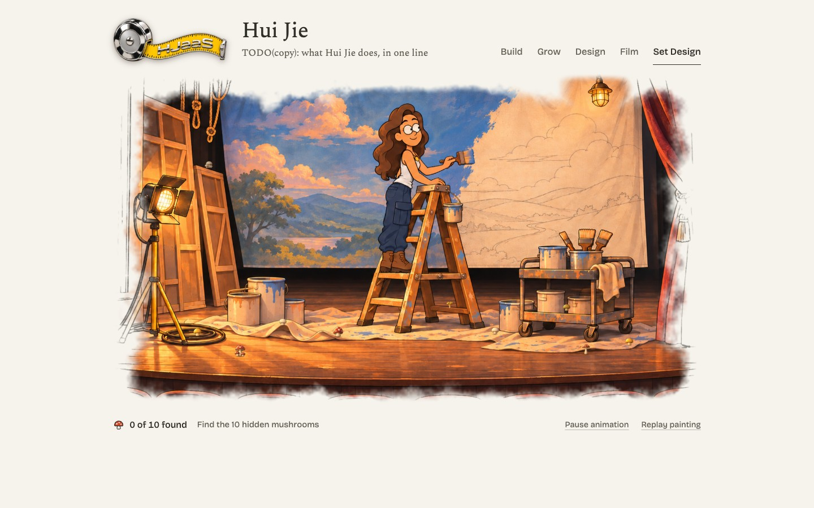

# Scene 5 "Set Design": build report 01

From: Fable. For: Wren and the user. 2026-11-21. Brief: `reviews/scene-5-build.md`.
Branch: `site/scene-5`, made from the tip of `origin/site/scene-4` (2e19df6), with the scene-5 files
brought from `main` by path (section 0). Nothing was merged into any branch and `main` was not touched.

**To see it**

```
cd ~/hjaas && git checkout site/scene-5 && git pull && cd site && npm install && npm run dev
```

- Set Design: http://localhost:5173/#set
- Its first-visit painting again: http://localhost:5173/?reset#set
- The backdrop at any stage: http://localhost:5173/?found=6#set (0 to 10)
- The unlock: http://localhost:5173/?all=49#set leaves only Set Design's last mushroom (`splatter`)



## 1. What was asked, and the result

| | Asked for (brief §) | Result | Evidence (`site/qa/…`) |
|---|---|---|---|
| ✅ | A fifth tab, "Set Design", at `#set`, lazy-loaded (§1) | After Film, label exactly "Set Design". Its plate comes with the page, its cast when the tab is first opened or hovered. `src/scenes/index.ts` says it took the place kept for Travel. | `scene5/set-1440x900.jpg` |
| ✅ | Built from `frames/022-theatre-scene/site/` and `set-lines.png`; package added like Film's (§2) | `npm run assets` makes `public/assets/scene5/` (2.3 MB with the plate): Rachel and the lamp as WebP at the size delivered, the ten swaths and the gap mask lossless, the walk track copied. `scenery`, `hunt_progress`, `sprite_track`, `sprites` and `mask` are read from `frames.json`; no actor is named in the build. | `scripts/build-assets.mjs`, `src/scenes/set-cast.json` |
| ✅ | 3a. The stagehand's boots (`sprite_track`) | `src/engine/walk.ts`. Each frame of a walk: track frame `floor(ms × 30 / 1000)`, no in-betweens; far boot first and 15% darker (made once at load), near boot over it, each turned about its bottom-centre; then only what is inside the gap mask is kept. Drawn over the swaths, under the lamp and Rachel; cleared after the last frame. All 137 frames of each walk shown, none skipped, none off the clock; the boots within 0 to 1 plate px of the package's own picture; across 534 frames no boot pixel outside the mask, and the ladder's feet, the pots and the cart never overdrawn. | `scene5/walk.json`, `walk-boots-*.jpg` |
| ✅ | 3b. The backdrop fills in (`hunt_progress`) | `src/engine/progress.ts`. Swath k shows once k of this scene's mushrooms are found. On a find it fades in over 700 ms ease-out from the same frame as her salute (10 to 11 ms after it; 700 to 717 ms; the curve followed exactly, never backwards), then is drawn into the one swaths canvas: no pop (mean change 0.07 of 255 in Chrome, 0.17 in WebKit). Reached swaths are simply there on a return visit or with reduced motion, and painted in with the scene on a first visit. | `scene5/fade.json`, `fade-bake-*.jpg` |
| ✅ | All 11 stages against the package (§8) | Each stage 0 to 10 against a straight alpha-over of `plate.png` + `P_01…P_k`: mean 0.29 to 0.75 of 255, the 99th percentile at most 2, the worst pixel 3. Nearly all of that is the plate's own WebP: against `room.webp` + the swaths it is 0 to 0.16. No seam or pale island in the ×8 difference pictures. Lossless swaths were enough; nothing else needed. | `scene5/stages.json`, `stages-0-5.jpg`, `stages-6-10.jpg`, `stages-compare-*.jpg` |
| ✅ | 3c. The stagehand's schedule | First walk 8 to 15 s after the scene settles (9.8 s measured), `rtl`, a wait of 10 to 15 s (10.1 s), `ltr`, then 40 to 70 s (69 s) and again, all rolled afresh. Paused mid-walk he holds the frame and carries on from it on Play; switched away and back he starts from a new first wait with nothing showing; with reduced motion he never walks, even when asked to. He never reacts and a find never interrupts a walk. | `scene5/walk.json` |
| ✅ | Lamp: L_00 to L_35 at 100 ms forever; reduced motion holds L_00 (§4) | In order, 100 ms a step (Chrome 98 to 102, WebKit 87 to 113), L_35 → L_00 without a hitch; held straight with reduced motion. | `scene5/react.json` |
| ✅ | Rachel's loop, blinks, and her salute cut straight in (§4) | The paint loop 3 to 6 times, the lean 2 to 3 s, the dip, as written. A find cuts to R_K1_salute from whatever pose she is in: 4 ms after a find during the lean, 1 ms during a stroke. Salute 1.9 to 2.1 s, then R_A1 400 ms, then the loop. | `scene5/react.json` |
| ✅ | A second find mid-salute extends it, never restarts (§4) | Found again 0.81 s into the salute: held 2.56 s in all, 1.75 s after the second find, one cut-in only (`again: 'hold'`). | `scene5/react.json` |
| ✅ | 10 mushrooms, 3 easy / 4 medium / 3 hard, full width (§5) | Section 3. Four, three and three in the thirds. | `scene5/hunt-*` via `scenes.test.ts`, `set-1440x900.jpg` |
| ✅ | Never on Rachel, a swath, the lamp or the gap (§5) | None is in Rachel's layer, the swaths' area, the lamp's layer or the band y 554 to 636; a test holds every future package to it. Tap boxes 44 px at every size, none overlapping. | `scenes.test.ts`, `edge/pencil-spots.json` |
| ✅ | `aPaint` ≥ 0.95 under every mushroom and tap box (§5) | 1.00 under every drawing and tap box at five sizes. | `edge/pencil-spots.json` |
| ✅ | Every mushroom findable | All 50, five scenes, clicked or tapped on the drawing: desktop, the iPhone profile and a 320 px phone. | `edge/pencil-find.json` |
| ✅ | 6. The prize: all 50 | The unlock is worked out from the finds on load and after every find (every spot of every scene); a saved `unlocked` from the old rule is ignored. A scene at 10/10 shows as done ("You found all 10 here. 40 more in the other scenes") with no Contact button; the 50th find, in any scene, brings the button with its announcement ("All 50 mushrooms found…") and focus. `?all=N` added; `NEEDS` has Set Design instead of Travel; the placeholder copy and the two `index.html` descriptions count the whole site. | `scene5/film.json`, `set-*-unlock.mp4`, `set-*-10of10-no-unlock.jpg`, `src/engine/unlock.test.ts` |
| ✅ | 7. Pencil edge B with round 3b's reveal | The painting: the pencil never more than 50 px ahead of the colour, no paint past the colour's edge, bare paper stays paper, every pencil point reached by a stroke before the wash; the rim paper all round. | `edge/pencil-reveal-set.json`, `pencil-reveal-set-*.jpg`, `pencil-rim.json` |
| ✅ | Rachel fully painted (§7) | `aPaint` = 1.00 under all 18,322 points she ever covers, no pencil over her. | `edge/pencil-rachel.json` |
| ✅ | The lamp's cage painted under its whole swing (§7) | Kept by `'hug'` boxes following the swing, band by band, as traced on all 36 stills (the Merlion's mechanism). Over the cage, across every still: at least 0.968 from plate y 25 down; its very top row (y 24) is in the rim's own 28 px fade, 0.945. The rope above fades into the paper with the rim, like the fly ropes. | `scene5/set-1440x900.jpg` |
| ✅ | Phones open on plate x 930 (§7) | 615 to 1242 at 390 × 844 and 616 to 1243 at 360 × 740: all of Rachel's layer and the start of the bare canvas. Panning as elsewhere. | `scene5/shots.json`, `set-390x844*.jpg` |
| ✅ | The menu with five tabs at 320 px (§7) | Two rows, both centred, every tab 44 px tall, "Set Design" whole on one line, no scrolling. From 350 px up the tabs close up to stay on one row. | `scene5/set-320x640-menu.jpg` |
| MEMORY_ROW
| ✅ | 60 fps on a throttled phone, during a fade and a walk (§8) | Chrome slowed four times, production build: Set Design's painting, at work, the fade and a walk all 17 ms a frame. Trace: the painting 0 of 360 frames dropped (longest task 13 ms), at work 0 of 156, a find with its fade 0 of 180 (longest 31 ms), a walk 1 of 276 (longest 25 ms). Section 4. | `traces/SUMMARY.md`, `scene5/frames.json` |
| ⚠️ | No long tasks over about 12 ms in WebKit (§8) | WebKit, iPhone profile, three runs: the painting, at work, a walk 19 ms at the longest frame, a find 19 to 26 ms. As in every scene the frames are a little over 16.7 ms but none over 33 ms here; two longer frames elsewhere (section 4). | `scene5/frames.json` |
| ✅ | Screenshots (§8) | 1440 × 900; 390 × 844 as it opens and panned to each end; 360 × 740; the menu at 320. | `scene5/set-*.jpg` |
| ✅ | Recordings (§8) | Desktop and iPhone: (1) 45 s from settled with the default schedule: the boots out at 9.8 s and back at 27.5 s, finds at 6 s and 22.3 s, the lean at 12.1 s, the dip at 15.4 s; (2) the 10th find from `?found=9`: the last swath fades in with her salute, the scene shows done; (3) the unlock from `?all=49`: the Contact button 1.7 s after the find, focused and announced; and a 10/10 scene without the unlock; (4) reduced motion: no walk, the lamp still, swaths without a fade. | `scene5/set-desktop-*.mp4`, `set-iphone-*.mp4` and their stills |
| ✅ | The boots at 1:1 (§8) | Both directions, frames 10 to 130, the page beside the package at scale 1 and 2: they roll and plant and never slide. One thing for Wren (section 6): the package's mask is open over the curtain. | `scene5/walk-boots-*.jpg` |
| ✅ | Against the preview (§8) | Rachel −0.8/−0.7, the lamp −0.2/−0.1 and the boots −0.5/0.1 screen px from where the package puts them. | `scene5/preview.json`, `preview-compare.jpg` |
| ✅ | Trace on the throttled phone (§8) | The painting, a find with its fade, and a walk; and round all five scenes. | `traces/SUMMARY.md` |
| ✅ | Checked against the animation standards (§8) | Section 5. | |

Tests: 196 pass (`npm test`). `tsc` clean, production build fine.

## 2. The three engine additions, as built

- **Not actors.** `cast.ts` takes `hunt_progress` and `sprite_track` layers out of the cast. They have their
  own routine entries (`backdrop`, `stagehand`), which are checked and read there.
- **The swaths (`progress.ts`).** One canvas, the size of the ten swaths' area, holds every swath reached,
  drawn once in order: the page never draws ten swaths a frame. A new swath fades in by opacity alone on a
  small canvas over it (the compositor's work, cheap on a phone) and is drawn in when the fade ends. Two
  finds in quick succession fade in together and are drawn in in order. The next swath is kept decoded, so
  a fade starts on the find. Away from the scene the canvas is given back.
- **The boots (`walk.ts`).** One canvas over the gap (1672 × 83 plate px). It keeps time on Rachel's own
  player's frames, so there is no second loop. Time moves on only while the scene is at work, shown, not
  paused and not in reduced motion.
- **The salute at once.** A config option, `answer: 'at-once'`, makes the player start the reaction from
  whatever pose she is in. The other scenes still wait for their rest pose.

## 3. The hunt

| id | Difficulty | Where |
|---|---|---|
| `coil` | hard | Yellow, inside the coiled cable at the floodlight's foot, beside the yellow tripod. |
| `flats` | medium | A pale cluster on top of the shorter leaning flat, against the dark curtain behind it. |
| `boards` | easy | Red, on the floodlit boards, front left. |
| `pots` | hard | A pale cap on the drop cloth at the foot of the tall paint pot. |
| `drop-cloth` | easy | Red, on the pale cloth left of the ladder. |
| `ladder` | medium | A chanterelle on the ladder's back cross brace, below Rachel. |
| `paint-pail` | hard | A pale cap on the pale cloth beside the pail in front of the cart. |
| `cart-shelf` | medium | Yellow, on the cart's lower shelf between its pots. |
| `cart-front` | easy | Red, on the front edge of the right-hand drop cloth. |
| `splatter` | medium | Yellow, among the blue splatters at the cloth's right-hand end. |

- **The hard ones are hidden by likeness, not darkness:** yellow by the yellow tripod, pale caps among the
  pale pots and cloth. Each is lit.
- **Three suggested places are not used.**
  - The curtain's tassel and the fly-rope knots are inside the edge's reach of the rim, so there is no "red
    against the curtain".
  - The rag on the cart, and the ladder's lowest left rung, sit in the gap where the boots walk (the mask is
    open there).
- **Two were nudged from where they were first placed** (`pots` 17 px right, `cart-front` 17 px down and 5
  px left), so their tap boxes never overlap a neighbour's on a 320 px phone.

## 4. Frame times and traces

Production build, the Mac calm (load 2.1 to 2.6).

**WebKit, iPhone profile, three runs**

- **Set Design:** its painting, at work and a walk all 19 ms at the longest frame; a find with its fade 19 to
  26 ms.
- **Switches:** the short brush 19 to 26 ms, except one frame of 62 ms (and 41 ms) coming back to Set
  Design in the first run. Build opened for the first time: 41 to 61 ms (the standing exception).

**Chrome, processor slowed four times:** everything in Set Design 17 ms (a find 17 to 50 ms). Every
short-brush switch has one frame of 83 to 133 ms at the tap, as in every scene since review 05 (the room's
picture decoded again).

**Traces (phone profile, 4×)**

| Part | Frames begun | Dropped | Longest task |
|---|---|---|---|
| Set Design's painting | 360 | 0 | 13 ms |
| At work | 156 | 0 | 3 ms |
| A find and its swath's fade | 180 | 0 | 31 ms |
| A walk (4.6 s) | 276 | 1 | 25 ms |
| Round the five scenes (four first visits, three short-brush switches) | 2444 | 40, where each scene goes on the plate | 131 ms (the room's picture decoded again) |

## 5. Against the animation standards (`.claude/skills/review-animations/STANDARDS.md`)

| | Standard | Set Design |
|---|---|---|
| ✅ | No flicker on cuts | Every pose change replaces the whole canvas in one draw; the stills are identical outside the part that moves. |
| ✅ | The swath's fade is smooth and never pops | Ease-out 700 ms on opacity alone, never backwards; drawn in at its end with no visible change (0.07 of 255). |
| ✅ | The lamp loops without a hitch | L_35 → L_00 at the same 100 ms as every step. |
| ✅ | The boots' timing is even | One track frame per 33 ms, no skips, no repeats beyond the frame rate. |
| ✅ | Easing | The fade is the site's ease-out; everything else cuts, as the package asks. |
| ✅ | Feedback is immediate | The salute starts within a frame of the find, and the swath with it. |
| ✅ | Interruptible | A second find holds the salute; pause holds the boots mid-stride; leaving clears them. |
| ✅ | Reduced motion means fewer and gentler | No walks, the lamp hangs still, swaths appear without a fade, one held salute. |
| ✅ | Prefer transform and opacity | The fade is opacity; the boots are a canvas drawn only while they move, on the lead's frames. |

## 6. Decisions I made, and things for Wren

**Decisions**

1. **`hunt_progress` and `sprite_track` layers are not actors.** Their routine entries are matched by name
   (`backdrop` for `backdrop_01…10`).
2. **The salute cutting in is a scene option, `answer: 'at-once'`**, so the other scenes are unchanged.
3. **The swaths and the gap mask are lossless WebP.** They meet the plate and each other with no seam, and
   cost little (about 0.7 MB for the ten).
4. **The lamp's cage is kept with `'hug'` boxes**, as the Merlion's head is. Its top row is as whole as the
   rim's own fade allows (0.945).
5. **The menu closes up below 374 px and wraps, centred, below 350 px.** The wrap moved the picture by a
   fraction of a pixel, which showed a one-pixel line of the room above the picture in WebKit; the window
   now leaves out its own top and bottom pixel (paper anyway). That applies to every scene.
6. **The edge is the scene's first.** It already fitted every mushroom and tap box. One stroke was added
   down the far left so the brush reaches every pencil point before the wash.
7. **Away from Set Design it keeps 0.6 MB:** the boots' sprites and the mask, ready for the next walk.
8. **The unlock work** (section 6 of the brief) is built as specified. `?found=` no longer unlocks anything;
   `?all=` wins over it when both are given.

**For Wren**

- **The gap mask is open over the right-hand curtain** (plate x 1560 to 1672, y 560 to 637). On the return
  walk the far boot is drawn on the red curtain (frame 130), in the package's own preview too
  (`scene5/walk-boots-ltr-x1.jpg`, last row). At 1440 the painting's edge hides most of it, but a phone
  panned right shows the curtain at that height. Closing the mask there fixes it, with no code change.
- **Her blinks come further apart than the rule's 3 to 6 s** (3.8 to 8.5 s seen): she blinks only in the
  R_A1 holds marked `blink_ok`, so a blink that falls due during a stroke or the lean waits. As the data
  says; marking more holds, or a blink still for the lean, would even them out.
- **The tassel and the fly-rope knots** were too near the rim to hide a mushroom fairly (section 3).

## 7. Not done, or not verified

- Nothing was tested on a real phone.
- The dust motes (brief §9): not built, as asked.
- No copy for this scene yet; the prize lines are still `TODO(copy)` placeholders.
- Scenes 3, 4 and 5 are still separate branches, to be merged in order (3, then 4, then 5).
