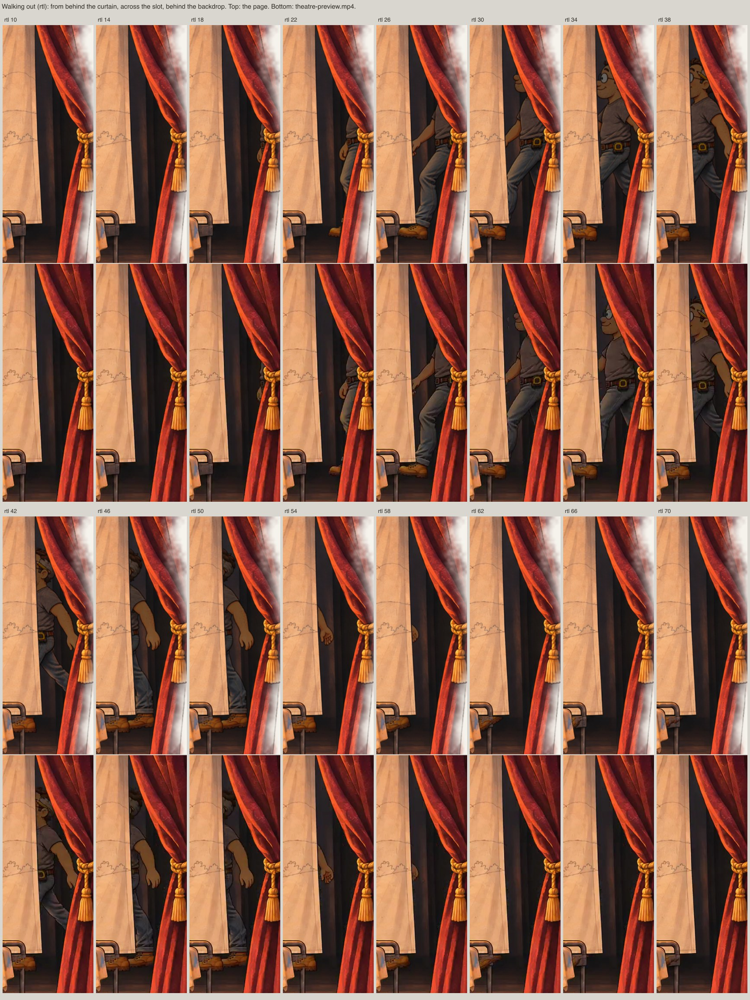

# Scene 5 "Set Design": build report 02 (the stagehand)

From: Fable. For: Wren and the user. 2026-11-23. Brief: `reviews/scene-5-build-round2.md`.
Branch: `site/scene-5`, with the new package brought from `main` by path (section 0), the old one removed
first. **The art is final:** while I was working, `main` received all 16 finished body drawings (13c939b) and the
brief was updated to ask for them. I ran the same two commands again, no code changed, and the checks that
depend on the drawings were run again on them. Nothing was merged into any branch and `main` was not touched.

**To see it**

```
cd ~/hjaas && git checkout site/scene-5 && git pull && cd site && npm install && npm run dev
```

- http://localhost:5173/#set. He sets out 8 to 15 s after the scene settles.
- **On a phone, drag the picture all the way to the right first.** The phone opens on Rachel, and the slot by
  the curtain is outside that window.
- Recordings: `site/qa/scene5/set-desktop-crossing-60fps.mp4` (the whole page, out and back) and
  `set-desktop-slot-60fps.mp4` (the slot alone).



## 1. What was asked, and the result

| | Asked for (brief §) | Result | Evidence (`site/qa/scene5/…`) |
|---|---|---|---|
| ✅ | The new package in from `main` by path, the old one gone (§0) | `frames/022-theatre-scene/site` replaced whole; `boot_L` and `boot_R` are gone from the package and from the built assets. `npm run assets` run in full. | `git log` |
| ✅ | A sprite per entry, drawn in order; the body entries; mirrored on the way back (§2, §3.1) | `src/engine/walk.ts`. Each entry names its sprite. Boots: the far one 15% darker. Body: never darkened, mirrored about its bottom-centre when `flip`. 42 frames compared with the package at 1:1: the right frame each time, no whole-pixel shift in any. | `walk.json` |
| ✅ | The canvas the size of the body mask; boots clipped by the gap mask, body by the body mask (§3.2) | All 598 frames: no pixel outside that frame's mask, nothing left over from an earlier frame. On screen, 24 frames over the whole plate (13.6 million pixels): not one pixel outside the masks changes. | `walk.json` |
| ✅ | 60 fps, the frame by time (§2) | 299 of 299 track frames shown each way, none skipped, none shown twice; 4983 ms. | `walk.json`, `film60.json` |
| ✅ | Schedule, pause, reduced motion, hidden scene as before (§3.2) | First walk 9.8 s, back 10.1 s after, next in 64.6 s; paused he holds frame 67 and carries on; away and back starts a new first wait; reduced motion never walks. | `walk.json` |
| ✅ | Memory (§3.3) | 30 orders: 77.8 MB at most (the lab; round 1 was 78.4). Set Design opened first takes 38.5 MB for a returning visitor and 42.6 MB for a new one (round 1: 23). **Away from it, 0 MB** (round 1 kept 0.6). | `memory.json` |
| ✅ | No mushroom or tap box in the slot (§4) | None of the ten is near it, so none moved: still 3/4/3. A test now holds them out of the slot. All 50 found again at three sizes. | `src/scenes/scenes.test.ts`, `../edge/pencil-find.json` |
| ✅ | 1:1 strips of the slot, both ways, beside the preview (§5) | From behind the curtain, across as a whole man, behind the backdrop with the boots under the hem; and back into the curtain. | `strip-slot-rtl.jpg`, `strip-slot-ltr.jpg` |
| ✅ | The hand-over (§5) | Every 60 fps frame around it. The switch changes **fewer** pixels than the middle step of the walk: 134 px at rtl 74 (median 180), 117 px at ltr 216 (median 168). Nothing jumps at the switch. | `strip-handover-rtl.jpg`, `strip-handover-ltr.jpg`, `strips.json` |
| ✅ | The left end (§5) | His boots go behind the leaning flat; the last pixel ever shown is at x 368, where the gap ends. Nothing shows between the flats. | `strip-left-rtl.jpg`, `strip-left-ltr.jpg`, `strips.json` |
| ✅ | A 60 fps recording, out and back, default schedule (§5) | Playwright's own video is 25 fps, so the frames come from Chrome's screencast, each with its own time, put together at 60 fps. 256 frames captured on the way out and 270 back; the track has 223 and 216 new drawings. | `film60.json` |
| ✅ | A throttled-phone trace with the body frames (§5) | See section 3: 300 frames, none dropped. | `../traces/SUMMARY.md` |
| ✅ | Tests and the rest | 196 tests pass, type check clean, no console errors. Rachel's salute, the lamp and the edge checks re-run. In WebKit the tool's first find read 26 ms to the salute in two runs (round 1: 6); 12 more finds measured on their own were 6 to 18 ms, within a frame. | `react.json`, `preview.json`, `../edge/pencil-*.json` |

## 2. What changed in the engine

- **Pictures are decoded only while the scene is showing.** The 48 sprites and two masks are downloaded with
  the cast, decoded (off the page's thread) as the scene goes on, and given back when it goes off.
- **Darker copies** are made only of the boots the track draws far.
- **The masks are shipped as alpha,** made by `npm run assets`, so the page has nothing to convert.
- **Only the part of the canvas he is on is touched each frame,** not all 1672 × 536 of it. Only the part of
  the body mask his body ever reaches is kept (1 MB rather than 3.6).
- **The canvas sits under the edge, the lamp and Rachel,** as before.

## 3. Frame times and traces

Production build.

| Trace (phone, 4× slower) | Frames begun | Dropped | Longest task |
|---|---|---|---|
| Out, panned right to the slot, 5 s from his first showing (the body, then the boots) | 300 | 0 | 5 ms |
| Back, 5 s from the boots' first showing (the boots, then the body) | 300 | 0 | 2 ms |

Taken with the final art. A first visit's paint-in trace was not taken again (the frame times below cover it).
The frame times and the memory orders were taken just before the final drawings arrived; the 16 new ones are
the same size (316 × 459), so they decode to the same memory.

- **WebKit, iPhone profile, three runs:** a walk 19 ms at the longest frame. Set Design's painting 19 to 24
  ms, its short brush 21 to 30 ms, a find 18 to 36 ms. Build opened for the first time 43 to 65 ms and Grow
  once 54 ms (as before: the standing first-visit exceptions).
- **Chrome, slowed four times:** a walk 17 ms. Every short-brush switch has one frame of 83 to 117 ms at the
  tap, as in every scene since review 05 (round 1: 83 to 133).

## 4. Against the animation standards (`.claude/skills/review-animations/STANDARDS.md`)

| | Standard | The walk |
|---|---|---|
| ✅ | Purpose and frequency | An occasional, ambient event: once in 40 to 70 s; he never reacts and never interrupts anything. |
| ⚠️ | Even timing, no stutter | The page shows one track frame per 16.7 ms, none skipped or doubled, and the boots are smooth. The body drawings are held 2 to 7 frames each: section 6, point 1. |
| ✅ | Constant motion is not eased | He walks at the drawn cycle's own pace, as the package asks. |
| ✅ | Nothing from nothing | He comes from behind the curtain and goes behind the backdrop; he never fades or pops in. |
| ✅ | Interruptible | Pause holds him mid-stride; leaving clears him; coming back starts a new wait. |
| ✅ | Reduced motion | He never walks. |
| ✅ | Inside the frame budget | Only a small canvas drawn per frame; the longest task 5 ms at 4× slower. |

## 5. Decisions I made

1. **The painting hugs the slot (`SLOT` in `src/scenes/set.ts`).** With round 1's right edge the paper took
   his arm and his belt as he crossed, so he was not seen whole. The edge now follows the slot's right-hand
   outline, with the same "hug" used for the lamp's cage, and the tassel and curtain edge are painted there.
   Every pixel he ever shows is whole (the fade comes no nearer than 16 px), the rim still ends on paper,
   and no pencil point is left to the wash. This is the one visible change outside the stagehand. To undo
   it, delete `...SLOT` from `keep`.
2. **Each walk starts half a frame in.** The frame is still `floor(ms × fps / 1000)`. Counted from 0, a 60
   fps track on a 60 Hz screen lands on the edge between two frames, and Safari rounds its times to whole
   milliseconds, so now and then a frame would be shown twice and the next skipped.
3. **Sprites are drawn where the track says, to a tenth of a pixel.** The preview rounds to whole pixels,
   which makes a difference of under half a pixel.
4. **The pencil map's file changed by 11 faint pixels** (`pencil-tb.webp`). Round 1's file was built while the
   stagehand's empty layer was wrongly counted as part of the room. It is now right, and the edge checks
   were run on it.

## 6. For Wren

1. **The body is drawn about 16 times a second.** The final art fixed the lurch I had measured on the first
   package (his head moved 2 to 60 px per drawing; now 10 to 38). But each drawing is still held in place for
   2 to 7 frames, so in the slot he moves in steps, most visibly over `L_B05` (38 px after a hold of 6 frames)
   and `L_B06`. The boots change more often. The brief says to draw the frames as they are, so I have not smoothed
   it; more drawings there would be the cure, if the user's phone check calls for it.
2. **A hand ahead of him, a hand behind him.** Walking back, his hand shows at the backdrop's edge 10 frames
   before he does (ltr 230 to 239); walking out, it is the last thing to leave (rtl 51 to 60). Natural in
   a swing, but the hand is alone in the slot for a tenth of a second or so. The stray arm after he had gone behind
   the curtain, in the interim drawings, is gone.
3. **Two frames after the hand-over** (ltr 218, `L_B15` to `L_B16`) a boot steps out 760 px at once. That is
   the pose change, not the switch, and well under the walk's largest step (2038 px).
4. **A hair of a seam in the body mask.** At plate y 556 to 557 the mask is only 35 to 50% open across the
   slot (x 1483 to 1567), where the gap's top edge meets the slot. It falls on his cuff's own dark line and
   I could not see it at 1:1. Closing it in the mask would be safe.
5. **The phone window.** He can only be seen whole on a phone after panning right (the window is plate x 615
   to 1242; the slot is at 1505 to 1606). Round 1's phone start was chosen for Rachel, so I left it.
   Telling me to start the phone elsewhere is a one-line change.
## 7. What was not done

- **No real phone.** The user's phone check is next.
- The desktop and iPhone 45 s recordings (`set-desktop-45s.mp4`, `set-iphone-45s.mp4`) are retaken with the
  new stagehand, but the iPhone's window is on Rachel and the left, so it shows boots only. The 10th-find,
  unlock and reduced-motion recordings of round 1 were not retaken; nothing in them changed but the edge by
  the curtain. The pictures named `walk-boots-*.jpg` are round 1's, and show the old boots.
