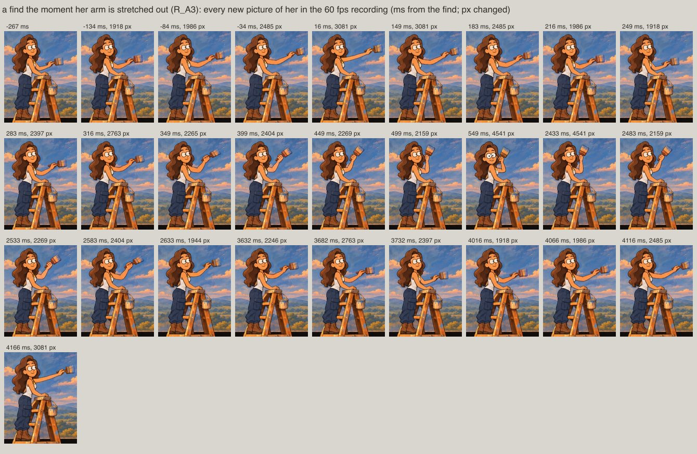

# Scene 5 "Set Design": build report 03 (Rachel's in-betweens)

From: Fable. For: Wren and the user. 2026-11-25. Brief: the "Round 3" section of
`reviews/scene-5-build-round2.md` (on `main`). Branch: `site/scene-5`, with the package brought from `main` by
path (e432c49, section 0's commands) and `npm run assets` run. Nothing was merged into any branch and `main`
was not touched.

**To see it**

```
cd ~/hjaas && git checkout site/scene-5 && git pull && cd site && npm install && npm run dev
```

- http://localhost:5173/#set. Watch a stroke, then find a mushroom while her arm is stretched out.
- Recordings: the seven `site/qa/scene5/moves-*-60fps.mp4`. Beside each is a picture of every drawing in it
  (`moves-*.jpg`).



## 1. What was asked, and the result

| | Asked for | Result | Evidence (`site/qa/scene5/…`) |
|---|---|---|---|
| ✅ | The package in again, `npm run assets` | Replaced whole; 14 new stills. Rachel's seven old stills, the plate and the stagehand's track are identical. | `git log` |
| ✅ | `reaction.lead_in` | A find plays the package's way back to rest from the still she is showing, then the salute. Not listed: the salute straight away. A second find never replays it. | `moves.json`, `react.json` |
| ✅ | `min_show_ms` 120, `min_show_by_still` (lean 500), or the still's own time if shorter | Found the moment A3 shows: 133 ms (the first frame past 120). The moment she leans: 500 ms. On an in-between: its own 50 ms. Shown long enough already: she moves on the next frame or two. | `moves.json` |
| ✅ | After the reaction, the routine at its next `R_A1` | Every time: R_A1 for 400 ms, then the routine's own rest hold, then the next move. | `moves.json`, `react.json` |
| ✅ | 60 fps recordings: stroke, dip, finds at rest, at A3, in the dip (and, extra, in the lean and on an in-between) | In all seven no drawing follows one the package does not put next to it, and every drawing the page showed is in the recording (12 to 19 of them). No jumps. | `moves-*-60fps.mp4`, `moves-*.jpg` |
| ✅ | Each in-between about 3 frames, lead-in 2, never skipped on the throttled phone | Phone slowed four times, 20 finds: 475 of 475 in-betweens held 3 frames. Lead-ins 22 at 2 frames, one at 4 over a late frame, and two the tool counted as lead-ins that are routine drawings of 3. **None skipped.** Desktop: 473 of 473 at 3, lead-ins 34 at 2 (and two counted as above). WebKit: 493 of 494 at 3, lead-ins 33 of 36 at 2, the others over late frames; none skipped. | `held.json` |
| ✅ | Memory: about 11 MB more on Set Design, released when hidden, page under 80 MB | Set Design opened first: 49.6 MB (round 2: 38.5) returning, 53.7 (42.6) new: **+11.1**. Away from it 0 MB. 30 orders: **77.8 MB** at most (the lab, as before). Every reaction in full. | `memory.json` |
| ✅ | The rest | 210 tests pass (14 new), type check clean, no console errors. Backdrop stages within 3 levels of the package (mean 0.29 to 0.75); the swath's fade 700 ms with no pop; Rachel, the lamp and the stagehand in place. | `stages.json`, `fade.json`, `preview.json` |

## 2. What changed in the engine

- **`clips.ts`:** reads and checks the three new fields, and loads the lead-in's stills. Without them a reaction
  is come into as before, so the other four scenes are unchanged.
- **`player.ts`:** waits out the least time, plays the lead-in and the reaction as one, then goes to the routine's
  next rest step.
- **In such a routine one drawing at most is passed per frame.** A late frame holds the move up; it never cuts a
  drawing out of it. A move starts half a frame in, so the screen's rounding cannot give one drawing four frames
  and the next two.
- **A fault the recordings caught, fixed:** the answer first began at the click, between two frames, and its first
  drawing lost one of its own (in the dip it was never seen). It now begins on a frame.
- **Tests (`entry.test.ts`)** play the real package: a find from every still in `lead_in`, 720 moments chosen at
  random, a slow phone's late frames, Safari's whole-millisecond clock. I broke the code on purpose in several
  ways, and added tests where a break went unnoticed.

## 3. Frame times and traces

- **Trace** (phone 390 × 844 × 3, slowed four times, production build): at work 300 frames begun, 1 dropped;
  three finds 210 each with 1, 0 and 0 dropped; longest task 34 ms. The painting: 6 dropped in the first tenth of
  a second, before the brush moves, where a 52 ms task puts the cast on the plate. Round 1's trace had 13 ms
  from 1.0 s and no such task; 14 more stills are drawn once there. `../traces/SUMMARY.md`.
- **Against round 2's build, in turn, 30 finds each:** the longest frame of a find has the same median in
  throttled Chrome (33 ms both; 1.07 and 1.17 frames over 25 ms per find) and no worse in WebKit (36 ms, now 28).
  Single finds reach 367 ms (Chrome) and 233 ms (WebKit) in round 3, 350 and 315 in round 2.
  `frames-r3-vs-r2.json`. The Mac's load was 5 to 7, so the long frames are partly the machine's.
- **`frames.json` is still round 2's.** My first full run of it was on a busy Mac (load 14 at the start) and was
  slower even in scenes this round does not touch; it is not kept.

## 4. Against the animation standards

| | Standard | Her moves |
|---|---|---|
| ✅ | Nothing jumps | Every pair of drawings is one the package plays next to each other. |
| ✅ | Interruptible | A find turns the move round from where it is. |
| ✅ | Feedback comes soon | First move 16 to 32 ms after a find (at rest, in the dip), 49 on an in-between, 133 at a fresh A3, 498 at a fresh lean. The mushroom, counter and swath answer at once. |
| ✅ | Reduced motion and pause | One held salute at once: no lead-in, no arm travel. |
| ✅ | Inside the frame budget | Section 3. |

## 5. Decisions I made

1. **"Never in the middle of a move" and "own planned time".** An in-between on screen at the find finishes its
   50 ms, and the lead-in starts from it. The preview looks up the still that would come next instead; the brief
   says the still she is showing, so I followed the brief. Both are one step apart.
2. **The time on screen is counted from when the drawing appeared,** so two steps in a row on `R_A1` count as one.
3. **The swath starts fading at the find,** as in `theatre-preview.mp4`, while the salute now comes 0.2 to 0.8 s
   later. `routine.json` says "starting with her reaction"; if you want it to wait, say so.
4. **The extra 320 to 480 ms beat** the engine adds after a reaction is left out here: the package brings its own.
5. **Evidence.** The dip-find recording was made without the stagehand: Chrome's recorder stalled for 250 ms at a
   find during a walk, though the trace shows the page drawing every 16.7 ms. The page itself was not changed.

## 6. For Wren

1. **The ten backdrop patches came with the package, changed.** The brief does not mention it. Their unfinished edges
   differ (up to 12,900 px, up to 171 levels, all inside the swaths' area); the finished picture differs by at
   most 12 levels over 3,000 px. They look the same to me side by side, so I took them as delivered.
2. **Two whole-head changes remain, by design of arm-only drawings:** `R_T_A1_B2_3` to `R_B2_dip` (6,045 px,
   her head bows in one step) and `R_T_A1_K1_3` to `R_K1_salute` (4,541 px, her head turns). The lean is
   a cut, as you said (8,731 px). Every other step is 1,900 to 3,100 px. If the phone check still finds the dip
   or the salute abrupt, those two are where.
3. **A find in the first half second of a lean takes 0.8 s to reach the salute** (0.5 of it the lean's own 500 ms).

## 7. What was not done

- **No real phone.** The user's phone check is next.
- The 45 s, 10th-find, unlock and reduced-motion recordings are still older ones and show her moves without the
  in-betweens. The edge and find-every-mushroom checks were not run again: her covered area, the pencil map and
  every hiding place are unchanged.
- **Another session.** An automated job was started on this branch by mistake at 22:55 and stopped. It committed
  nothing. I restored what it had changed (a section in `traces/SUMMARY.md`, a stash of two of my files, a half-written
  `memory.json`) and ran the memory check and the build comparison again, alone.
