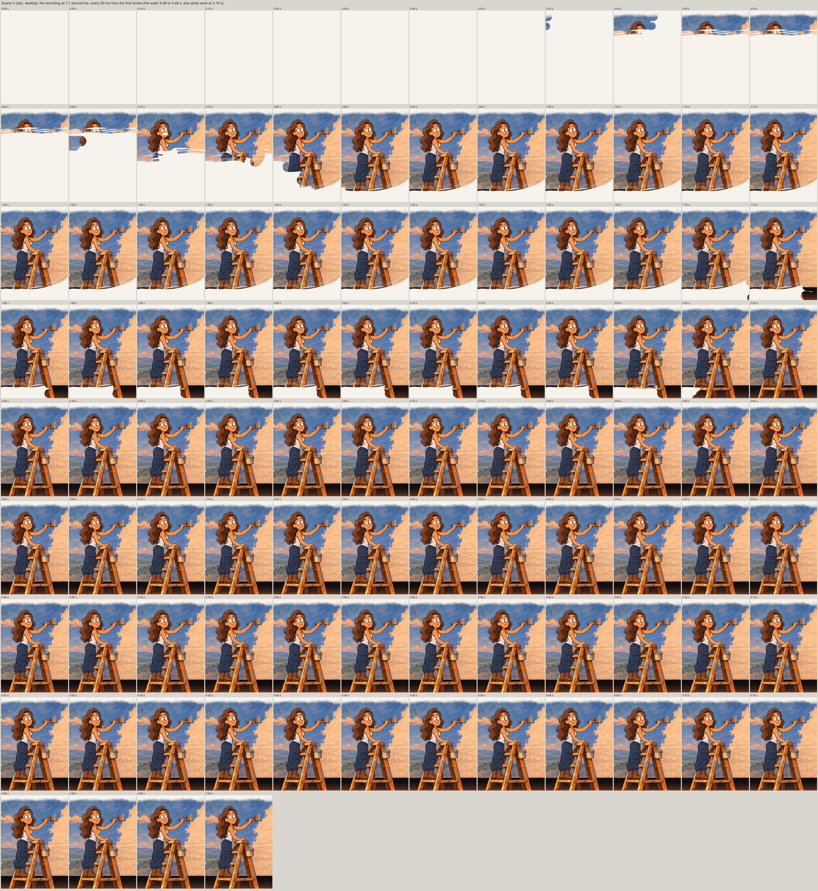

# Scene 5, round 4: build report 04 (Rachel painted in with the room, all scenes)

From: Fable. For: Wren and the user. 2026-11-25. Brief: `reviews/scene-5-build-round4.md` (on `main`), and job 002's
extra (review 03's 52 ms task). Branch: `site/scene-5`. Nothing was merged and `main` was not touched.

**To see it**

```
cd ~/hjaas && git checkout site/scene-5 && git pull && cd site && npm install && npm run dev
```

- http://localhost:5173/?reset#set (and `#build`, `#grow`, `#design`, `#film`), or "Replay painting".
- Recordings: `site/qa/paint/scene{1..5}-paint-60fps.mp4` (1440 × 900) and `…-paint-phone-60fps.mp4` (390 × 844).



## 1. What was asked, and the result

| | Asked for | Result | Evidence (`site/qa/paint/…`) |
|---|---|---|---|
| ✅ | She goes under the sheet | The sheet lies over everyone: Rachel, whoever is drawn over her, her shadow, the mushrooms. Only the painting's edge is above it. | `states.json` |
| ✅ | She holds still while painted | She and the cast are drawn before the clock and not again: **0 draws on any canvas of the cast** from the first stroke to 4.7 s. She starts work at 4.74 s, as before: 0.26 s after the wash ends. | `states.json` |
| ✅ | No fade, no 4 px settle | Both removed, and the code that hid her. | `transition.ts` |
| ✅ | The veil re-timed | It washes at the sheet's own pace, so the pencil and the picture finish together (4.48 s). | `transition.ts` |
| ✅ | Stroke plans | Checked, **none changed**: she is never last or alone. 98% painted at: Build 2.7 s, Grow 3.1, Design 3.2, Film 3.5, Set Design 0.8 (of 4.3). | `plan.json` |
| ✅ | 60 fps recordings, desktop and phone | Ten. Desktop: no recorded gap over 34 ms from the first stroke to 4.4 s. Phone: the few in Build and Grow are strokes outside the window. | `*-60fps.mp4`, `paint.json` |
| ✅ | 1:1 strips every 50 ms | Ten, 0 to 4.95 s. | `scene{N}-rachel-strip.jpg`, `-phone.jpg` |
| ✅ | No frame with the room painted and she not | **0 in all ten recordings** (section 2). Round 3's build fails the same test in all five scenes. | `paint.json`, `before.json` |
| ✅ | Throttled-phone trace, scenes 1 and 5 | Painting: 8 runs, 0 dropped in each. Longest task 4 to 11 ms (round 3: 4 to 11). | `trace.json`, `../traces/SUMMARY.md` |
| ✅ | WebKit | Set Design, 4 runs: longest frame 20 to 28 ms (round 3: 24 to 27), none over 50. Grow: 20 to 23 (24 to 27). | `webkit.json`, `webkit-before.json` |
| ✅ | Switch and return visit | No flash: section 3. | `switch-*.mp4`, `return-visit-60fps.mp4`, `switch.json` |
| ✅ | Unchanged cases | Slow network: she arrives late and fades in (279 ms). `?intro=off`, reduced motion, Skip and Replay all right. | `states.json` |
| ✅ | `npm test`, types, console | 210 tests pass, type check clean, no console errors. | |

## 2. The test for "the room is painted and she isn't"

The same for every scene, on every recorded frame from the first stroke to 4.7 s (231 to 278 frames each):

- **Her:** the pixels of her first frame's silhouette, by how near each is to her finished drawing. **The room around
  her:** a ring 70 plate px wide, by how far each has come from paper to picture.
- **It fails** if the room is 98.5% painted and she is under 95%. The same again along her outline: the 14 px of her
  inside it against the 14 px of room outside it.
- It took two corrections, so the final version was run on both builds. At first it skipped pale pixels (Grow's floor is 20 levels from
  the paper) and then it could not see her missing against a similar colour (Build).

| Frames that fail (whole of her, desktop / phone) | Build | Grow | Design | Film | Set Design |
|---|---|---|---|---|---|
| Round 3 | 8 / 4 | 88 / 72 | 63 / 63 | 62 / 62 | 137 / 135 |
| Round 4 | 0 / 0 | 0 / 0 | 0 / 0 | 0 / 0 | 0 / 0 |

In 24 slices of her outline (a finer look, not the pass mark) two places show up: Design, the slice at her
tablet hand for 0.6 s (1.65 to 2.25 s), where one stroke ends on her; and one frame in Build. See section 6.

## 3. Switch and return visit

- **First visit (Build to Set Design):** the old picture fades, the sheet is blank for 0.38 s, then the painting. In
  the 40 frames between, none of her shows.
- **Short brush:** she comes up only under the strokes; in 93 frames she never goes back by any amount.
- **Return:** she and the room fade up together (at most 0.1% apart).

## 4. The 52 ms task (review 03)

- **What it was.** One task on blank paper did everything: the scene on the plate, the logo, the contact form's
  rehearsal. The cast's stills were then rehearsed in idle moments that the painting did not wait for.
- **The 6 drops came before the brush.** With a mark added at the clock, round 3's build drops 6 to 11 frames on blank
  paper and none after. Review 03's window counted from navigation.
- **Now** each part has a frame of its own, and the painting waits for `Scene.drawn()`: every still of every actor rehearsed
  at its real size, the backdrop's pieces and the stagehand's pictures decoded. The last cast draw is
  over 200 ms before the clock (`states.json`). The wait is capped at 1.5 s.
- **Setting up:** longest task 36 to 49 ms at 4× slower, with one run of 102 in eight (round 3: 76 to 93). The clock starts
  10 to 30 ms later on the slowed phone in Chrome; in WebKit 0.13 s later on Set Design (about 0.65 to 0.78 s) and 0.06 s on Grow. 3 to 12 frames are still dropped there, with nothing on screen moving.
- The page now sets a performance mark, `hj-paint`, at the clock, so a trace of the production build finds it.

## 5. Decisions I made

1. **Everyone goes under,** not just Rachel: anyone drawn over her too.
2. **The caption's layer is made before the clock.** With her fade gone, WebKit made it as it faded in (33 to 36 ms in
   three of four Set Design runs). It is removed with the sheet.
3. **`Character.rehearse()` also fixes** a still rehearsed after being given back (the old loop would have drawn a closed
   image if the visitor left in the first second).
4. **Two files per scene:** phone recordings and strips are named `-phone`.

## 6. For Wren

1. **Look at Design, 1.65 to 2.1 s** (`scene3-rachel-strip.jpg`): half her face is painted for about half a second because the doorway stroke's
   edge runs down it, until the counter's stroke comes. It reads as paint, but a face half-done is the most
   noticeable moment of the five. The brief's rule (never last, never alone) holds, so I left the plans alone; a small move of that stroke's edge off her face would be the thing to try.
2. **Build, 0.8 to 2.0 s:** the top of her head alone, over the wall, for the same reason.
3. **Set Design paints her early** (0.45 to 0.85 s), so she is there from the start.

## 7. What was not done

- **No real phone.** Memory was not measured again: nothing new is kept.
- The traces are headless Chrome driven by a script, not the DevTools MCP; same profile and processor rate.
- The painting recordings are of the production build; the switch and state checks are of the dev server.
- `.DS_Store` and `.impeccable/` were untracked in the working tree before I started; I left them alone.
